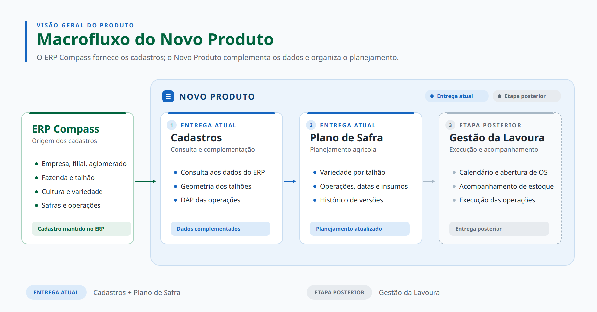

# 3 Escopo

O Plano de Safra organiza o planejamento das atividades agrícolas de uma propriedade ao longo da safra.

O planejamento define as culturas e variedades de cada talhão, as operações agrícolas, as datas previstas e os insumos necessários, incluindo suas doses e quantidades.

Cada plano de safra é cadastrado no nível **safra, fazenda e cultura**: existe um único plano para cada combinação (ex.: safra 2026/2027 · Fazenda Santa Clara · Soja). Dentro do plano, o planejamento é feito por talhão.

A consolidação dessas informações permite comparar a demanda de insumos com o estoque disponível, identificar necessidades de aquisição e estimar os custos da safra.

Assim, o Plano de Safra centraliza informações para apoiar decisões agronômicas, operacionais e financeiras.

Nesta entrega estão contemplados os Cadastros e o Plano de Safra. O acompanhamento de estoque e a execução das operações fazem parte da etapa posterior (Gestão da Lavoura), conforme o macrofluxo abaixo.

## Macrofluxo

