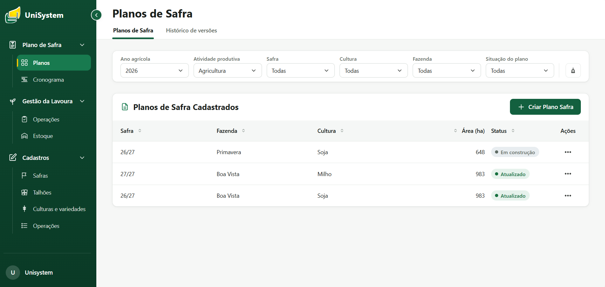

# 4.0 Menu e navegação

## Objetivo

Apresentar como o Plano de Safra se organiza: o menu lateral, presente em todas as telas, reúne as páginas do produto em três grupos, na ordem do trabalho na fazenda. Esta seção descreve a ordem dos grupos e dos itens e o comportamento do menu (expandir, recolher, minimizar grupos e destacar a página aberta).

## Acesso

O menu fica à esquerda, em todas as telas do produto.

> 📷 **Print do protótipo:** o menu recolhido (só ícones), com a página Planos aberta.

## Descrição da tela

O menu é uma faixa vertical verde, com três partes: o topo, os grupos de páginas e o rodapé.

### Topo

O ícone da UniSystem e o nome **UniSystem**. Na borda direita do menu, um botão redondo com uma seta, que recolhe e expande o menu ("Recolher menu" / "Expandir menu", ao passar o mouse).

### Grupos e itens

Três grupos, nesta ordem. Cada grupo tem um ícone, um nome e uma setinha à direita; embaixo, os itens do grupo, um pouco recuados, cada um com o seu ícone:

| Ordem | Grupo | Itens, na ordem | O nome do grupo leva a |
|---|---|---|---|
| 1 | **Plano de Safra** | 1. **Planos** · 2. **Cronograma** | Planos |
| 2 | **Gestão** | 1. **Operações** · 2. **Estoque** | Operações |
| 3 | **Cadastros** | 1. **Safras** · 2. **Talhões** · 3. **Culturas** · 4. **Tarefas** | Safras |

### Ícones do menu

Os ícones estão na pasta `icone/` do projeto, em SVG, com traço na cor do texto do menu. O nome de cada arquivo diz onde ele fica.

| Lugar no menu | O que o ícone mostra | Arquivo |
|---|---|---|
| Topo: logo UniSystem | Logo da empresa | `logo_unisystem.png` (só existe em PNG) |
| Grupo Plano de Safra | Folha com um broto | `icone_menu_plano_safra.svg` |
| Plano de Safra › Planos | Quatro quadrados | `icone_menu_plano_safra_planos.svg` |
| Plano de Safra › Cronograma | Barras de tempo | `icone_menu_plano_safra_cronograma.svg` |
| Grupo Gestão | Broto | `icone_menu_gestao.svg` |
| Gestão › Operações | Prancheta com check | `icone_menu_gestao_operacoes.svg` |
| Gestão › Estoque | Armazém | `icone_menu_gestao_estoque.svg` |
| Grupo Cadastros | Lápis sobre um quadro | `icone_menu_cadastros.svg` |
| Cadastros › Safras | Bandeira | `icone_menu_cadastros_safras.svg` |
| Cadastros › Talhões | Polígonos lado a lado | `icone_menu_cadastros_talhoes.svg` |
| Cadastros › Culturas | Espiga | `icone_menu_cadastros_culturas.svg` |
| Cadastros › Tarefas | Lista com marcadores | `icone_menu_cadastros_tarefas.svg` |
| Setinha ao lado do nome do grupo (minimizar e abrir) | Seta para baixo | `icone_menu_grupo_minimizar.svg` |
| Seta da borda (recolher e expandir o menu) | Seta para a esquerda | `icone_menu_recolher_expandir.svg` |
| Menu do usuário › Configurações | Engrenagem | `icone_menu_usuario_configuracoes.svg` |
| Menu do usuário › Sair | Porta com seta para fora | `icone_menu_usuario_sair.svg` |

Para que serve cada item:

- **Plano de Safra › Planos:** a lista dos planos de safra (filtros, criar plano, histórico de versões). É por ela que um plano é aberto, com as abas Planejamento · Resumo · Validação.
- **Plano de Safra › Cronograma:** as safras do ano agrícola por empresa e fazenda, numa linha do tempo.
- **Gestão › Operações:** o acompanhamento das operações planejadas e executadas (guias Acompanhamento · Calendário · Desvios de data · Central OS).
- **Gestão › Estoque:** o consumo de insumos frente ao planejado (guias Desvios de dose · Risco de falta de produto).
- **Cadastros:** as bases do planejamento: Safras, Talhões, Culturas e Tarefas (seções 4.1 a 4.4).

Os grupos Plano de Safra e Cadastros fazem parte desta entrega. As páginas de Gestão fazem parte da etapa posterior (ver 3 Escopo).

### Rodapé

Separado por um traço, o usuário: um círculo com a inicial e o nome (ex.: "U" e "Unisystem"). Clicar nele abre as opções **Configurações** e **Sair**. Em **Configurações › Aparência**, o usuário escolhe **Claro** ou **Escuro**, que vale para todas as telas.

### Recolher e expandir o menu

1. Com o menu expandido, clicar na seta da borda (**Recolher menu**).
2. O menu fica estreito e mostra só os ícones: somem o nome UniSystem, os nomes dos grupos e dos itens, as setinhas dos grupos e o nome do usuário (fica só o círculo com a inicial).
3. Os itens de cada grupo ficam sempre à vista, num bloco um pouco mais escuro embaixo do ícone do grupo, inclusive os de um grupo que estava minimizado.
4. Ao passar o mouse num ícone, aparece o nome do grupo ou do item.
5. Clicar no usuário abre as opções ao lado do menu.
6. Para voltar, clicar na seta da borda (**Expandir menu**): o menu volta com os nomes, e os grupos voltam abertos ou minimizados como estavam.

### Minimizar e abrir um grupo

1. Com o menu expandido, clicar na setinha à direita do nome do grupo (**Minimizar <grupo>**, ao passar o mouse).
2. Os itens do grupo somem e a setinha gira para a direita; o nome do grupo continua à vista e continua levando à sua página.
3. Clicar de novo na setinha (**Abrir <grupo>**) mostra os itens outra vez.

## Origem dos dados

O menu é fixo: os grupos, os itens e a ordem são os desta seção, iguais para todos os usuários. O nome e a inicial do rodapé são os do usuário que entrou no sistema.

## Regras de Negócio

**Ordem do menu.** Plano de Safra (Planos · Cronograma), Gestão (Operações · Estoque) e Cadastros (Safras · Talhões · Culturas · Tarefas), sempre nesta ordem.

**Nome do grupo.** Clicar no nome de um grupo abre o primeiro item dele: Plano de Safra → Planos; Gestão → Operações; Cadastros → Safras.

**Página aberta em destaque.** O item da página aberta fica destacado em verde, com um traço amarelo à esquerda; os outros ficam sem destaque. Nas páginas com guias (ex.: Operações), o destaque fica no item, qualquer que seja a guia aberta.

**Plano aberto destaca Planos.** Com um plano aberto (em qualquer das abas Planejamento, Resumo ou Validação), o item destacado é **Planos**. Não há item de menu para um plano: ele só abre pela lista de planos.

**Menu começa expandido.** Ao entrar no sistema, o menu aparece expandido (ícone e nome) e com todos os grupos abertos.

**Recolher e expandir.** A seta da borda alterna entre o menu expandido (ícone e nome) e o recolhido (só ícones). Recolhido, o nome aparece ao passar o mouse.

**Menu recolhido mostra todos os itens.** Com o menu recolhido, as setinhas dos grupos somem e os itens de todos os grupos ficam à vista, mesmo os de um grupo minimizado.

**Minimizar grupo.** A setinha à direita do nome do grupo esconde e mostra os itens daquele grupo. Cada grupo é independente.

**Escolha mantida ao navegar.** Menu recolhido ou expandido e grupos minimizados ou abertos continuam como o usuário deixou ao trocar de página. A escolha não é guardada: ao sair do sistema e entrar de novo, o menu volta expandido e com todos os grupos abertos.

## Cenários de teste

1. Entrar no sistema: o menu aparece expandido, com os três grupos abertos, nesta ordem: Plano de Safra (Planos · Cronograma), Gestão (Operações · Estoque), Cadastros (Safras · Talhões · Culturas · Tarefas).
2. Clicar em cada item: abre a página dele e o item fica destacado; os outros ficam sem destaque.
3. Clicar no nome de cada grupo: Plano de Safra abre Planos; Gestão abre Operações; Cadastros abre Safras.
4. Abrir Operações e trocar de guia (ex.: Calendário): o item Operações continua destacado.
5. Abrir um plano pela lista e passar pelas abas Planejamento, Resumo e Validação: o item Planos fica destacado em todas.
6. Clicar na seta da borda: o menu recolhe e mostra só os ícones, sem setinhas nos grupos e com o usuário só pela inicial. Passar o mouse num ícone: aparece o nome.
7. Com o menu recolhido, clicar de novo na seta: o menu volta expandido.
8. Minimizar o grupo Gestão: os itens Operações e Estoque somem; o nome do grupo continua levando a Operações. Clicar de novo na setinha: os itens voltam.
9. Minimizar um grupo e recolher o menu: os itens do grupo minimizado aparecem. Expandir o menu: o grupo volta minimizado.
10. Recolher o menu e trocar de página: o menu continua recolhido. Expandir o menu, minimizar um grupo e trocar de página: o grupo continua minimizado.
11. Clicar no usuário, no rodapé: aparecem Configurações e Sair (com o menu recolhido, ao lado do menu). Em Configurações › Aparência, trocar para Escuro: todas as telas passam para o modo escuro.
