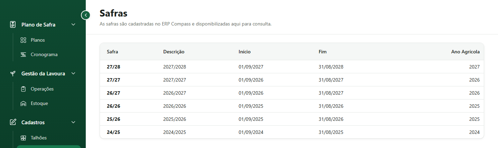
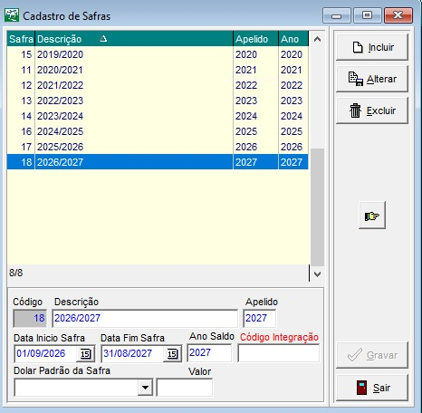

# 4.1 Cadastros › Safras

## Objetivo

Consultar as safras cadastradas no ERP Compass. Esse cadastro estrutura o planejamento agrícola por safra, fazenda e talhão e alimenta os filtros de Ano Agrícola e Safra do Novo Produto.

## Acesso

Menu **Cadastros › Safras**.

*No print, o protótipo ainda mostra a safra pelo nome curto (26/27) e o Ano agrícola pelo ano do início. Valem esta tabela e as regras abaixo.*

## Descrição da tela

Acima do título, a trilha **Cadastros › Safras**. Título **Safras** e o subtítulo "Consulte as safras cadastradas no ERP Compass."

Um quadro com o título **Safras cadastradas**, a etiqueta **Consulta · ERP Compass** e uma tabela, sem filtros e sem ações:

| Coluna | Campo no ERP Compass | Formato | Exemplo |
|---|---|---|---|
| Safra | Descrição | Texto | 2026/2027 |
| Data início | Data Início Safra | dd/mm/aaaa | 01/09/2026 |
| Data fim | Data Fim Safra | dd/mm/aaaa | 31/08/2027 |
| Ano agrícola | Ano Saldo | Número | 2027 |

O Ano agrícola aparece em todas as linhas, mesmo quando se repete. Todas as colunas com o mesmo texto (sem negrito). Sem informação no campo: mostrar "—".

## Origem dos dados

As safras **vêm do ERP Compass**. No Plano de Safra elas **não se criam, não se editam e não se excluem**; a tela é só de consulta.

**ERP Compass › Cadastro de Safras** (de onde vêm Descrição, Data Início Safra, Data Fim Safra e Ano Saldo):

## Regras de Negócio

**Período da safra.** A Data início e a Data fim são as do ERP Compass (Data Início Safra e Data Fim Safra); o Plano de Safra não calcula datas. No ERP, a safra vai de **01/09** de um ano a **31/08** do ano seguinte (ex.: 2026/2027, de 01/09/2026 a 31/08/2027).

**Ano Agrícola (de-para).** Ano Agrícola no Plano de Safra = **Ano Saldo** no ERP Compass. O valor vem do ERP, sem cálculo. Ex.: safra 2026/2027, Ano Saldo 2027 → Ano Agrícola 2027.

**Nome da safra.** Em todo o produto (esta tela, filtros, lista de planos, cabeçalho do plano), a safra aparece pela **Descrição** do ERP, como está cadastrada (ex.: 2026/2027). Não há nome curto.

**Safrinha.** A safrinha tem os dois anos iguais na Descrição (ex.: 2027/2027). Como as outras safras, o Ano Agrícola dela é o Ano Saldo do ERP.

**Ordem da tabela.** Da safra mais recente para a mais antiga, pelo Ano Agrícola. No mesmo Ano Agrícola, a safrinha vem antes da safra principal. Ex. (dados do print do ERP):

| Safra | Ano Agrícola |
|---|---|
| 2026/2027 | 2027 |
| 2025/2026 | 2026 |
| 2024/2025 | 2025 |

**Só consulta.** Não há botões de incluir, editar ou excluir. Qualquer mudança é feita no ERP Compass e aparece aqui.

## Cenários de teste

1. Abrir Cadastros › Safras: a tabela mostra todas as safras do ERP Compass, com as quatro colunas (Safra, Data início, Data fim, Ano agrícola).
2. Conferir o nome: a coluna Safra mostra a Descrição do ERP (ex.: 2026/2027).
3. Conferir a ordem: mais recente primeiro; no mesmo Ano Agrícola, a safrinha antes da safra.
4. Conferir que não há como incluir, editar ou excluir uma safra.
5. Alterar uma safra no ERP Compass e conferir que a mudança aparece na tela.
6. Safra sem um dos campos no ERP: a célula mostra "—".
