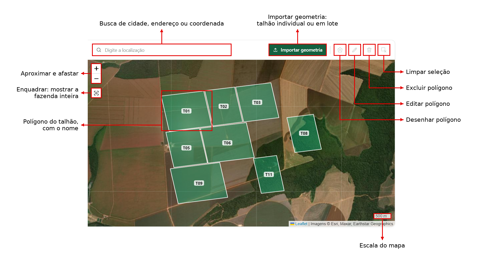

# 4.2 Cadastros › Talhões

## Objetivo

Mostrar os talhões de cada fazenda cadastrados no ERP Compass e permitir preencher o **polígono** (limite no mapa) de cada talhão: desenhando, editando, excluindo ou importando de um arquivo. O polígono é usado nos mapas do produto (planejamento do plantio e acompanhamento das operações).

## Acesso

Menu **Cadastros › Talhões**. Título da página: **Mapa de talhões**.

> 📷 **Print do protótipo:** Mapa de talhões com a lista à esquerda e o mapa à direita.

## Descrição da tela

Acima do título, a trilha **Cadastros › Talhões**. Título **Mapa de talhões** e o subtítulo "Visualize os talhões do ERP Compass e desenhe, importe ou edite seus limites no mapa."

### Filtros

| Filtro | Escolha | Regra |
|---|---|---|
| Empresa | Uma | Limita Filial, Aglomerado e Fazenda |
| Filial | Uma | Só as filiais da empresa escolhida; limita Aglomerado e Fazenda |
| Aglomerado | Uma | Só os aglomerados da filial escolhida; limita Fazenda |
| Fazenda | Uma (obrigatória) | Só as fazendas que cabem nos filtros acima |
| Talhão | Todos ou um | Escolher um seleciona o talhão e aproxima o mapa dele; Todos volta a mostrar a fazenda inteira |

Mudar um filtro limpa os de baixo que deixarem de caber. **Limpar filtros** (ícone de vassoura), sempre à mostra: Empresa, Filial e Aglomerado voltam para "Todas", o Talhão volta para "Todos" (sem talhão selecionado) e o mapa volta a mostrar a fazenda inteira. A Fazenda continua escolhida, porque é obrigatória.

### Lista de talhões (à esquerda)

- Título "Talhões da Fazenda <fazenda>", com o botão de recolher (a lista some e o mapa ocupa a largura toda; o botão **» Talhões** aparece na barra do mapa para mostrar a lista de novo).
- Resumo: número de talhões e soma da área cadastrada (ex.: "12 talhões · 1.185 ha").
- Etiqueta **Sem geometria: N**, só quando há talhão sem polígono. Clicar mostra só esses talhões; clicar de novo, todos.
- Tabela:

| Coluna | Origem | Formato | Exemplo |
|---|---|---|---|
| Talhão | Nome do talhão no ERP Compass | Texto | T04 |
| Área cadastrada (ha) | Área do talhão no ERP Compass | Número, até 1 casa decimal | 70 |
| Área geometria (ha) | Calculada pelo polígono | Número, até 1 casa decimal; sem polígono: "Sem geometria" | 68,4 |

- A tabela mostra só linhas inteiras; a rolagem para no começo de uma linha.

### Mapa (à direita)

- Imagem de satélite com os polígonos dos talhões da fazenda, todos na mesma cor. No polígono, o nome do talhão. Ao passar o mouse, a dica "T01 · Área geométrica: 100,0 ha" (nome do talhão e área calculada pelo polígono, com 1 casa decimal).
- O talhão selecionado tem contorno amarelo. Passar o mouse numa linha da lista destaca o polígono no mapa.
- O mapa sempre abre mostrando todos os talhões da fazenda. O botão **Enquadrar** (abaixo do + e −) volta a essa vista (ver Enquadrar).

### Barra sobre o mapa

| Item | O que faz | Quando fica ativo |
|---|---|---|
| Digite a localização | Busca cidade, endereço ou lugar no Brasil, ou uma coordenada (ex.: -12,552, -55,879), ao teclar Enter. Vários resultados viram uma lista; o lugar escolhido fica marcado com um ponto vermelho; o X limpa | Sempre |
| Importar geometria | Abre a importação (ver Importar geometria) | Fazenda com talhões |
| Desenhar polígono | Começa o desenho do talhão selecionado | Um talhão selecionado, sem polígono |
| Editar | Abre a edição do polígono | Um talhão selecionado, com polígono |
| Excluir | Exclui o polígono do talhão selecionado ou, com vários, de todos os selecionados que têm polígono | Talhão com polígono selecionado |
| Limpar seleção | Tira a seleção | Algum talhão selecionado |

Os ícones mostram o nome ao passar o mouse.

### Selecionar talhões

- **Clique** na linha da lista ou no polígono do mapa: seleciona aquele talhão. Pelo teclado, Enter ou espaço na linha.
- **Ctrl + clique** (na lista ou no mapa): junta o talhão à seleção ou tira dela.
- **Shift + clique** na lista: seleciona o intervalo, do último talhão clicado até este, na ordem da tabela. No mapa, o Shift funciona como o Ctrl.
- Com vários selecionados, o resumo mostra "· N selecionados" e o filtro Talhão, "N talhões selecionados". Desenhar e Editar ficam desativados ("selecione um talhão só").
- Clicar no mapa fora de um polígono limpa a seleção.

### Desenhar polígono

1. Com um talhão sem polígono selecionado, clicar em **Desenhar polígono**. Os outros talhões ficam apagados.
2. Embaixo do mapa, a faixa com a orientação: "**Desenhando T04** · Clique no mapa para marcar os vértices. Para salvar, clique no primeiro ponto. Esc cancela."
3. Clicar no mapa para marcar cada vértice. A faixa fica à vista durante todo o desenho.
4. Clicar no primeiro vértice fecha o polígono e já grava, sem passar pela edição; a faixa some e aparece o aviso "Polígono salvo". Para ajustar depois, **Editar**.
5. **Esc** cancela o desenho, sem gravar.

### Editar polígono

- **Vértices:** arrastar move o vértice; botão direito remove.
- **Novo vértice:** ao passar o mouse sobre um lado, o lado se destaca e um "+" acompanha o mouse; o clique cria o vértice exatamente naquele ponto.
- Faixa embaixo do mapa com "Editando T04" e os botões **Cancelar · Salvar**. Para excluir o polígono, usar o ícone Excluir da barra sobre o mapa, fora da edição.
- Depois de salvar, aparece o aviso "Polígono atualizado: T04 · 90,3 ha de área geométrica", e o mapa fica onde estava.

### Excluir polígono

- Pelo ícone Excluir da barra sobre o mapa (um talhão ou vários).
- Pede confirmação, só com a quantidade de talhões, sem os nomes: "Excluir o polígono de 1 talhão?" ou "Excluir o polígono de 3 talhões?". Os botões são sempre **Cancelar** e **Excluir**.
- Depois de excluir, o polígono sai do mapa e a lista mostra "Sem geometria" na Área geometria. Não há Desfazer: para voltar, desenhar ou importar de novo.

### Enquadrar

1. Clicar no botão **Enquadrar**, abaixo do + e − do mapa (dica: "Enquadrar todos os talhões da fazenda").
2. O mapa usa os pontos (latitude e longitude) dos polígonos dos talhões da fazenda, os mesmos que foram desenhados ou importados. Talhão sem polígono não entra.
3. Com esses pontos, o mapa calcula o menor retângulo que contém todos os polígonos: o ponto mais ao norte, o mais ao sul, o mais a leste e o mais a oeste.
4. O mapa se move até mostrar esse retângulo inteiro, com uma margem em volta, para os talhões não ficarem colados na borda.
5. A seleção, os filtros e a lista não mudam.
6. Fazenda sem nenhum talhão com polígono: o mapa mostra o Brasil inteiro (ver a regra "Fazenda sem polígono no mapa").
7. Fazenda sem nenhum talhão cadastrado: o mapa mostra o Brasil inteiro (ver a regra "Fazenda sem talhões").

### Importar geometria

Abre uma janela com o subtítulo "Escolha como deseja importar as geometrias." e duas abas: **Um talhão** (abre sempre nesta) e **Vários talhões**. **Trocar arquivo**, nas duas conferências, volta para a escolha do arquivo sem importar nada.

**Formatos aceitos:** "Shapefile (.zip ou .shp + .shx + .dbf + .prj), KML e KMZ." O arquivo pode ser solto na área indicada ou escolhido.

| Arquivo do Shapefile | Um talhão | Vários talhões |
|---|---|---|
| .shp | Obrigatório | Obrigatório |
| .shx | Opcional | Obrigatório |
| .dbf | Opcional | Obrigatório |
| .prj | Opcional | Opcional |

#### Um talhão

1. Campo **Talhão** (ex.: "T04 — 70 ha", com "· sem geometria" nos talhões sem polígono). Vem com o talhão selecionado no mapa ou, sem seleção, com o primeiro talhão sem geometria.
2. Escolher o arquivo. **O arquivo precisa ter um polígono só.**
3. **Prévia:** numa linha, Talhão (ainda dá para trocar) · Área cadastrada · Polígono atual (ou "Sem geometria") · Polígono do arquivo · Trocar arquivo. No mapa, os talhões cadastrados em cinza e o polígono do arquivo em verde, com o nome do talhão. Legenda "Talhão cadastrado · Talhão importado".
4. Botão **Importar polígono** ou, se o talhão já tem polígono, **Substituir polígono**. Depois, o talhão fica selecionado e o aviso diz "Polígono do T04 importado" (ou "substituído").

#### Vários talhões

1. Frase "As geometrias serão associadas aos talhões da Fazenda <fazenda> após conferência." e a escolha do arquivo.
2. **Conferência**, numa janela do tamanho da tela. Numa linha: **Coluna com nome dos talhões** · "N polígonos encontrados · N ha" · Trocar arquivo. Embaixo, a tabela e o mapa lado a lado.
3. **Coluna com nome dos talhões:** lista com as colunas do arquivo, cada uma com três valores de exemplo, busca "Buscar coluna..." e a opção **Nenhum**. Escolher uma coluna liga de novo os polígonos aos talhões pelos nomes daquela coluna. **Nenhum** chama os polígonos de "Polígono 1, 2…" e não liga nenhum sozinho.
4. **Tabela, uma linha por talhão do ERP Compass:** caixa de marcar · **Talhão no Compass** · **Área (ha)** · **Talhão no arquivo**. Ao lado do nome, a etiqueta **Sem geometria** (talhão ainda sem polígono) ou **Substitui** (talhão que já tem polígono e recebeu um do arquivo).
5. **Talhão no arquivo:** lista com busca "Buscar talhão...", o grupo **Disponíveis** (nome e área) e o grupo **Já associados nesta importação** (com "no T05" ao lado). Escolher um polígono já associado passa a ligação para este talhão. **Nenhum talhão** desfaz a ligação.
6. **Mapa da conferência:** polígonos do arquivo em amarelo (sem talhão) ou verde (ligados, com o nome do talhão); polígonos que os talhões já têm, em cinza. Legenda "Talhão cadastrado · Polígono sem talhão · Polígono ligado ao talhão". Clicar num polígono do arquivo abre ali a lista dos talhões do Compass para ligar; a linha correspondente pisca em verde na tabela.
7. Botão **Importar N polígonos**.

> 📷 **Print do protótipo:** conferência de Vários talhões, com a tabela e o mapa.

## Origem dos dados

Empresa, filial, aglomerado, fazenda e talhão **vêm do ERP Compass**, nesta hierarquia: Empresa › Filial › Aglomerado › Fazenda › Talhão. Do talhão vêm o **nome** e a **área cadastrada**. No Plano de Safra eles **não se criam, não se renomeiam e não se excluem**.

O único dado do talhão preenchido no Plano de Safra é o **polígono**. A fazenda não tem polígono; só os talhões têm.

> 📷 **Print do ERP Compass:** cadastro de talhões. De lá vêm: Fazenda, Talhão (nome) e Área.

## Regras de Negócio

**Cadastro vem do ERP.** Fazendas e talhões (nome e área) vêm do ERP Compass. No Plano de Safra não se criam, não se renomeiam e não se excluem. Excluir o polígono não exclui o talhão.

**Só o talhão tem polígono.** Cada talhão tem no máximo um polígono. A fazenda não tem polígono.

**Polígono a qualquer momento.** O polígono pode ser desenhado, editado, substituído e excluído a qualquer momento, e não só quando falta.

**Polígono válido.** Não se salva polígono com menos de 3 vértices nem com linhas que se cruzam.

**Área geométrica.** A área geométrica é calculada pelo polígono, em hectares, e não altera a área cadastrada do ERP. Aparece na coluna Área geometria da lista e na dica do polígono no mapa.

**Fazenda obrigatória.** A tela mostra uma fazenda por vez; o filtro Fazenda é obrigatório e a tela abre na primeira fazenda da lista.

**Filtros em cascata.** Empresa limita Filial; Filial limita Aglomerado; Aglomerado limita Fazenda; Fazenda limita Talhão. Mudar um filtro limpa os de baixo que deixarem de caber.

**Excluir com confirmação.** Excluir polígono (de um ou de vários talhões) pede confirmação. Depois de confirmado, não há Desfazer.

**Excluir em lote.** Com vários talhões selecionados, o Excluir vale para os que têm polígono; os sem polígono são ignorados.

**Coordenadas.** Sem o arquivo .prj, as coordenadas são lidas em WGS 84 (EPSG 4326). Se as coordenadas do arquivo forem UTM e faltar o .prj, a importação pede o .prj.

**Um talhão, um polígono no arquivo.** Na aba Um talhão, o arquivo precisa ter um polígono só. Com mais: "O arquivo tem N polígonos. Para importar um talhão, use um arquivo com um polígono só. Para vários talhões, use a aba Vários talhões."

**Arquivos obrigatórios.** Na aba Vários talhões, o Shapefile precisa de .shp, .shx e .dbf. Falta de um deles: "Falta o arquivo .shx. Para importar vários talhões, envie o shapefile com .shp, .shx, .dbf e .prj." (no .zip: "…dentro do .zip"). O .zip só aceita Shapefile.

**Ligação pelo nome.** Na conferência de Vários talhões, o polígono cujo nome (na coluna escolhida) é igual ao nome do talhão no ERP já vem ligado, sem diferença de maiúsculas e acentos (ex.: "talhao 04" liga com "Talhão 04"). Os outros talhões ficam em "Selecionar talhão", com a caixa desativada até a pessoa escolher.

**Linhas ligadas vêm marcadas.** Toda linha ligada vem marcada, inclusive a que substitui um polígono existente (etiqueta Substitui). Quem não quiser trocar, desmarca. A caixa do título marca ou desmarca todas as linhas ligadas.

**Um polígono por talhão na importação.** Cada talhão recebe um polígono só. Escolher para um talhão um polígono já associado a outro passa a ligação para o novo talhão.

**Enquadramento do mapa.** Enquadrar mostra o menor retângulo que contém todos os polígonos dos talhões da fazenda, com uma margem em volta e um limite de aproximação (uma fazenda pequena não fica perto demais). Só os talhões com polígono entram no cálculo.

**Quando o mapa enquadra sozinho.** Ao abrir a tela, trocar de fazenda, limpar os filtros, voltar o filtro Talhão para "Todos", concluir a importação de geometria e esconder ou mostrar a lista. Ao salvar um polígono ou mudar outro filtro da mesma fazenda, o mapa mantém a vista em que estava.

**Fazenda sem polígono no mapa.** O ERP Compass não tem a coordenada da fazenda. Por isso, numa fazenda com talhões e sem nenhum polígono, o mapa mostra o Brasil inteiro e, em cima dele, uma faixa na largura toda do mapa com o aviso "Esta fazenda ainda não tem talhões com polígonos cadastrados. Importe a geometria ou desenhe os talhões no mapa." e um **X** para fechar. A faixa some ao clicar no X, ao buscar uma localização em "Digite a localização" e quando a fazenda passa a ter um polígono (importado ou desenhado). Depois de fechada, não volta para aquela fazenda.

**Fazenda sem talhões.** Numa fazenda sem nenhum talhão cadastrado no ERP Compass, a lista mostra "Esta fazenda ainda não tem talhões" e "Os talhões (nome e área) são criados no ERP Compass."; o mapa mostra o Brasil inteiro, sem a faixa de aviso (não há talhão para desenhar nem para receber a geometria). Importar geometria, Desenhar, Editar e Excluir ficam desativados; Enquadrar mantém o mapa no Brasil inteiro.

**Sem criar talhão.** A importação não cria talhão. Polígonos do arquivo sem talhão ligado ficam de fora e aparecem só em amarelo no mapa. Talhão novo é criado no ERP Compass.

## Cenários de teste

1. Abrir Cadastros › Talhões: a tela abre na primeira fazenda da lista e mostra os talhões dela, com a área cadastrada do ERP Compass.
2. Filtros em cascata: escolher uma empresa e conferir que Filial, Aglomerado e Fazenda só mostram o que pertence a ela; trocar a empresa limpa os filtros de baixo que deixaram de caber.
3. Clicar na etiqueta "Sem geometria: N": a lista mostra só os talhões sem polígono; clicar de novo mostra todos.
4. Desenhar o polígono de um talhão sem geometria, salvar e conferir a Área geometria na lista.
5. Tentar salvar um polígono com linhas que se cruzam ou com 2 vértices: não salva.
6. Editar um polígono (mover, criar e remover vértice): a faixa mostra só "Editando T04", com Cancelar e Salvar; depois de salvar, a Área geometria da lista mostra a nova área.
7. Selecionar vários talhões com Ctrl e com Shift; conferir que Desenhar e Editar ficam desativados.
8. Excluir o polígono de vários talhões: pede confirmação com a quantidade ("Excluir o polígono de 3 talhões?"); ao confirmar, os polígonos saem do mapa, a lista mostra "Sem geometria" e não aparece aviso com Desfazer.
9. Importar Um talhão com um KML de um polígono: prévia no mapa e botão Importar polígono; num talhão com polígono, o botão é Substituir polígono.
10. Importar Um talhão com um arquivo de vários polígonos: aparece o aviso da regra "Um talhão, um polígono no arquivo" e não importa.
11. Importar Vários talhões com Shapefile sem o .shx: aparece o aviso da regra "Arquivos obrigatórios".
12. Importar Vários talhões: nomes iguais aos do ERP (com diferença de maiúscula ou acento) já vêm ligados e marcados; ligar um talhão clicando no polígono do mapa; importar e conferir os polígonos no mapa.
13. Na conferência, escolher para um talhão um polígono já associado a outro: a ligação passa para o novo talhão.
14. Importar um arquivo sem .prj com coordenadas UTM: a importação pede o .prj.
15. Aproximar e arrastar o mapa e clicar em Enquadrar: o mapa mostra todos os talhões da fazenda com polígono, com margem em volta; a seleção continua a mesma.
16. Numa fazenda com talhões sem polígono, clicar em Enquadrar: o retângulo considera só os talhões com polígono.
17. Trocar de fazenda: o mapa abre enquadrando os talhões da nova fazenda.
18. Escolher um talhão no filtro Talhão e depois voltar para "Todos": o mapa volta a mostrar a fazenda inteira.
19. Salvar um polígono: o mapa continua na vista em que estava.
20. Abrir uma fazenda com talhões e sem nenhum polígono: o mapa mostra o Brasil inteiro, com a faixa da regra "Fazenda sem polígono no mapa".
21. Na mesma fazenda, buscar uma localização: a faixa some. Em outra fazenda sem polígono, clicar no X: a faixa some.
22. Importar a geometria de uma fazenda sem polígono: a faixa não aparece mais.
23. Abrir uma fazenda sem nenhum talhão cadastrado: a lista mostra o aviso da regra "Fazenda sem talhões", o mapa mostra o Brasil inteiro sem a faixa de aviso e Importar geometria fica desativado.
24. Desenhar um polígono: a faixa "Desenhando T04" fica embaixo do mapa durante todo o desenho; clicar no primeiro vértice grava o polígono na hora e a faixa some. Começar outro desenho e apertar Esc: o desenho é cancelado, sem gravar.
